<picture>
  <source media="(prefers-color-scheme: dark)" srcset="docs/assets/banner-dark.svg">
  
</picture>

# Picket

[](https://github.com/Brokoli5191/Picket/actions/workflows/ci.yml)
[](https://github.com/Brokoli5191/Picket/releases)
[](https://github.com/Brokoli5191/Picket/releases)
[](LICENSE)
[-informational)](gradle/libs.versions.toml)
[](https://kotlinlang.org)
[](https://shizuku.rikka.app/)
[](docs/DECISIONS.md)
[](https://apps.obtainium.imranr.dev/redirect?r=obtainium://add/https://github.com/Brokoli5191/Picket)

Picket shows what is running on your Android phone and what keeps waking it up. It also lists every
app that holds a hook to read along: notification access, accessibility services, device admin,
usage access, overlays, keyboards, VPN and default roles. It needs no root, only
[Shizuku](https://shizuku.rikka.app/). You see every change before it runs, the journal keeps it,
and where Android allows it you can take it back.

> **Status: pre-release.** The commands Picket runs are written against the AOSP sources and tested
> against reconstructed output, but none is verified on a device yet. [docs/COMMANDS.md](docs/COMMANDS.md)
> tracks that, command by command.

## Screenshots

<table>
  <tr><th></th><th>Processes</th><th>Watchers</th><th>Wakeups</th></tr>
  <tr>
    <td>Light</td>
    <td>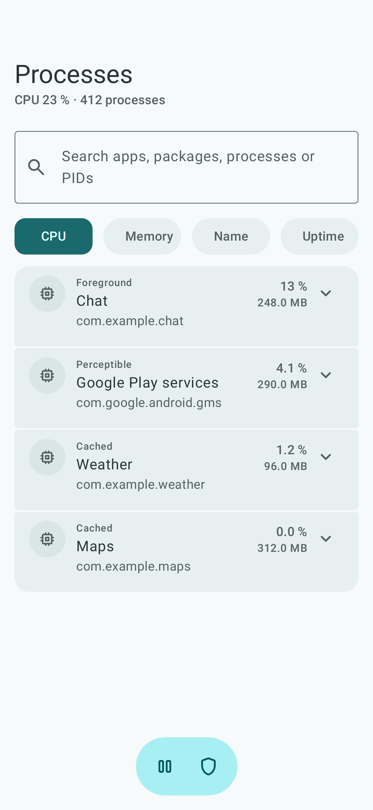</td>
    <td>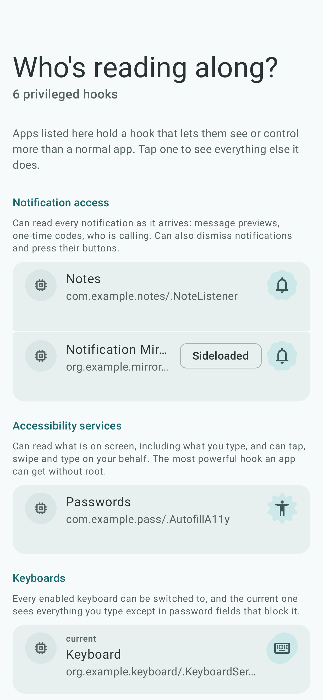</td>
    <td>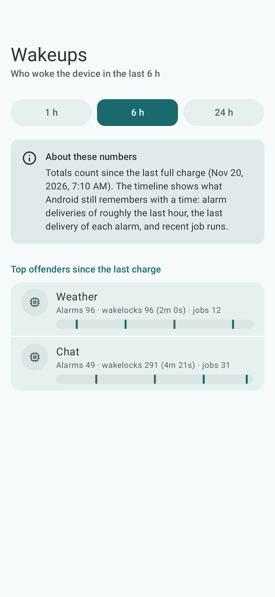</td>
  </tr>
  <tr>
    <td>Dark</td>
    <td>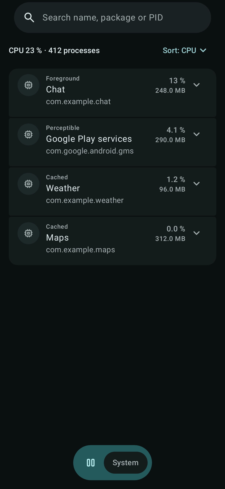</td>
    <td>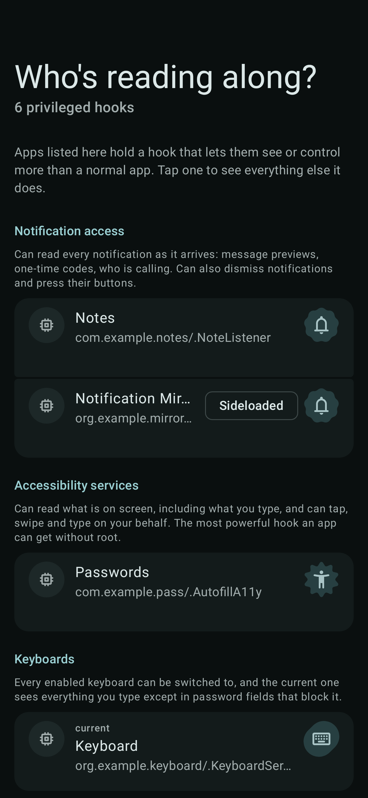</td>
    <td>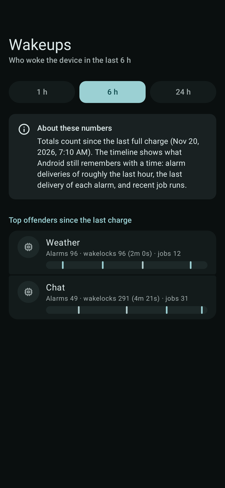</td>
  </tr>
  <tr><th></th><th>App detail</th><th>Actions</th><th>Journal</th></tr>
  <tr>
    <td>Light</td>
    <td>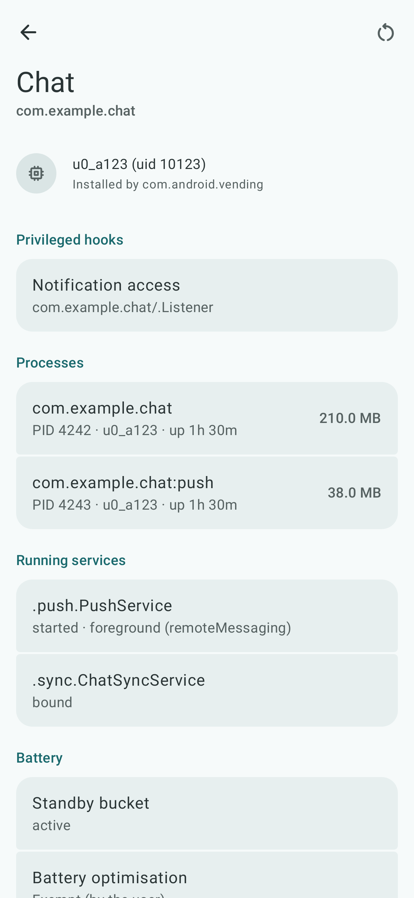</td>
    <td>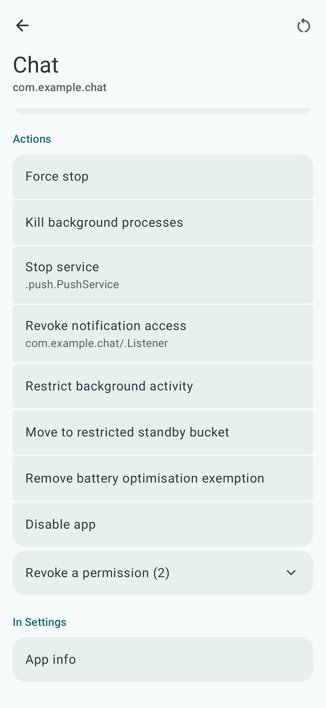</td>
    <td>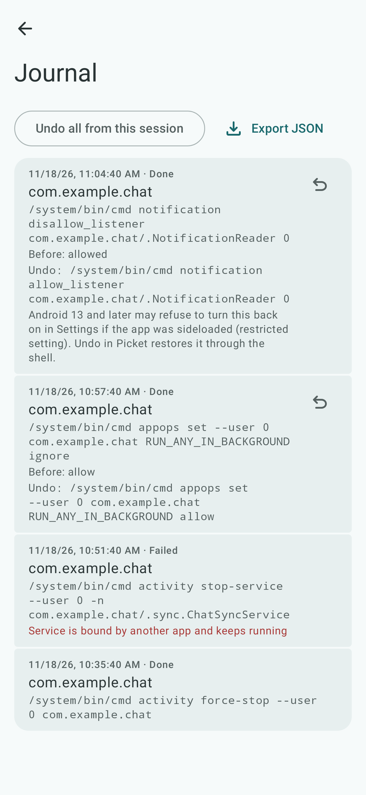</td>
  </tr>
  <tr>
    <td>Dark</td>
    <td>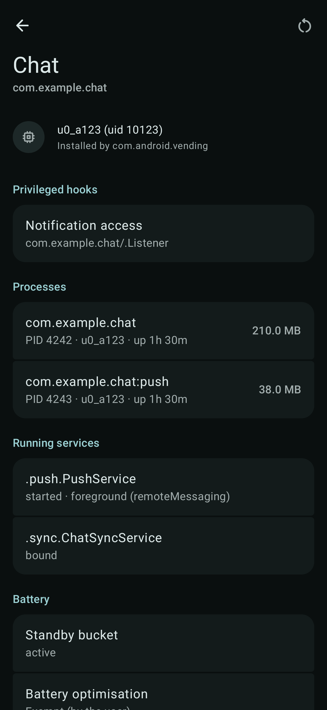</td>
    <td>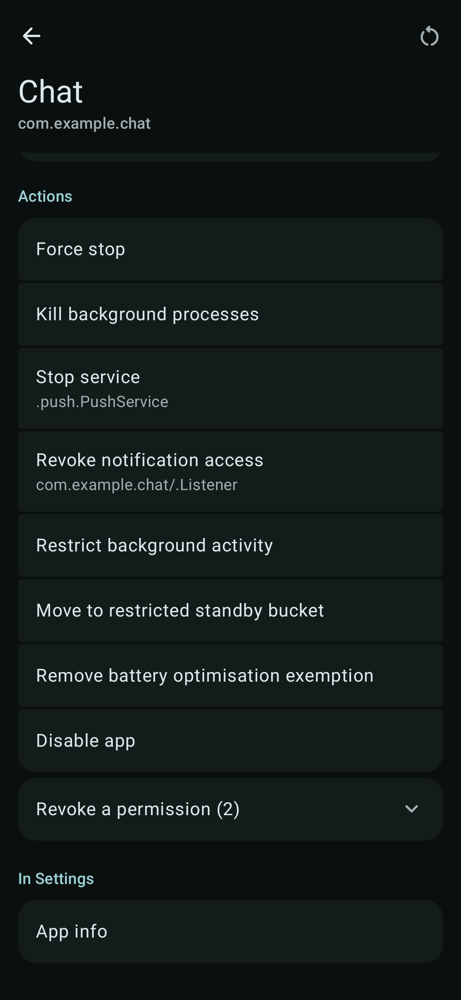</td>
    <td>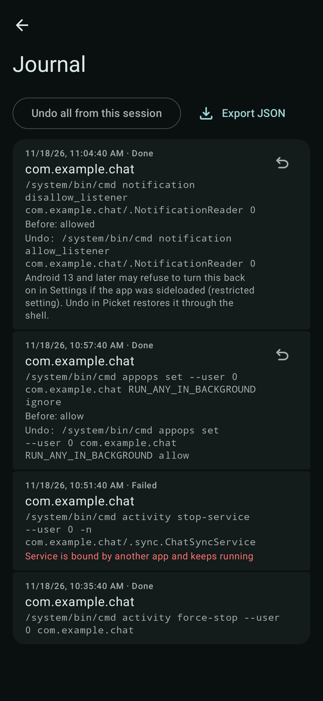</td>
  </tr>
</table>

The screenshot tests render these from invented sample data, so they always match the current
build. High-contrast and pure-black variants are in [docs/screenshots](docs/screenshots).
<!-- Demo GIF goes here once recorded: , see docs/RECORDING.md -->

## Features

### Processes

Every running app with its processes, grouped by app, with CPU share, memory, importance (foreground,
visible, perceptible, service, cached) and uptime. Sort by any of them, search by app, package,
process or PID, show or hide system apps, and pause the list to read it. Kernel threads, isolated
processes and shared system uids get their own groups. The list re-sorts at most every five seconds
and never under your finger.

The app detail adds what the process list cannot show: running services (started, bound,
foreground with their types), standby bucket, battery-optimisation exemption, granted runtime
permissions, app ops, wakeups since the last charge and the installer.

### Watchers

Picket was built for this screen. It lists every app that holds a privileged hook, what that hook
lets it see or do, and whether it is in use right now:

| Hook | What the app can do with it |
|---|---|
| Notification access | Read every notification, including message previews and one-time codes |
| Accessibility service | Read the screen and act on your behalf |
| Device admin | Lock the device, enforce policies, sometimes wipe it |
| Keyboard | Read everything you type |
| Usage access | See which apps you use and when |
| Display over other apps | Draw on top of other apps |
| VPN | See and route all network traffic |
| Default roles | Be your SMS app, dialer, assistant, browser or home screen |
| Do Not Disturb access | Change Do Not Disturb |

Sideloaded apps are marked: they did not come through a store, and since Android 13 the system
itself treats them with extra suspicion for exactly these hooks. If one source cannot be read on
your Android version, the screen says which one instead of quietly showing less.

### Wakeups

The top offenders since the last full charge (alarm wakeups, wakelocks with their held time, jobs)
from the battery statistics, and a timeline of what Android still remembers with a time stamp:
alarm deliveries of roughly the last hour, the last delivery of each alarm and recent job runs.

### Actions, journal and undo

Every action shows its risk, what it changes, the state before, and the exact command line it will
run plus the one that undoes it. Nothing runs before you confirm. Every result goes into a journal
with the command, its output and the previous state. Undo is then one tap, from the snackbar or the
journal, which shows the undo command next to each entry; "Undo all from this session" lists every
command and asks once. The journal exports to JSON.

## Actions and risks

| Action | Undo | Risk |
|---|---|---|
| Force stop | none needed, the app starts again when opened | low |
| Kill background processes | none needed | low |
| Stop a running service | none; force stop is offered if the service refuses | medium |
| Restrict background activity | restores the previous mode | low |
| Move to the restricted standby bucket | restores the previous bucket | low |
| Revoke notification access | grants it again | medium |
| Turn off one accessibility service (the others stay on) | restores the previous list exactly | medium |
| Revoke a runtime permission | grants it again | low |
| Revoke overlay or usage access | restores the previous mode | low |
| Remove a battery-optimisation exemption | adds it again | low |
| Remove a default role | makes the app the default again | medium |
| Revoke Do Not Disturb access | grants it again | medium |
| Disable an app for your user | restores its previous state | **high** |
| Device admin, VPN, keyboard | Picket opens the matching Settings screen | – |

**Protected apps.** Picket refuses to stop, restrict or disable the core of the system: `android`,
System UI, the phone app, Samsung's core packages, your current launcher and keyboard, Shizuku and
Picket itself. The helper process enforces this list, not the UI. Settings → Protected apps shows it.

> **Warning.** Disabling system packages can soft-brick One UI: boot loops, a missing launcher or
> keyboard, a dead phone app. Picket asks you to type the package name before it disables a system
> app, and undo restores it, but only while the phone still boots far enough to run Picket. If you
> are not sure what a package does, leave it alone.

On Android 13 and later, Settings blocks sideloaded apps from getting notification or accessibility
access back ("restricted setting"). Undo in Picket goes through the shell and restores it anyway.

## How it works

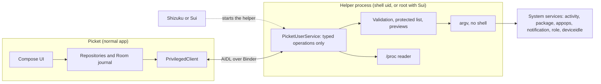

Shizuku starts a helper process for Picket with the rights of the adb shell (or root under Sui).
The helper does not offer a shell. It knows a fixed set of operations ("list processes", "plan this
action", "run this plan"), validates every package and component name it receives, and starts each
command as an argument list, never through `sh -c`. Before a change it sends back the exact command
for the preview; when you confirm, it checks that the command and the state are still the same.

Picket has no internet permission. A tool with shell rights should not be able to send anything
anywhere, and "trust us" is not enough: the build fails if any library adds the permission, and CI
checks the finished APK again.

## Setup

1. Install [Shizuku](https://shizuku.rikka.app/) and start it. On Android 11 and later this works
   on the phone alone through Wireless debugging (pair once from the Shizuku notification).
   Otherwise connect the phone to a computer and run the adb command the Shizuku app shows.
2. Open Picket and allow it in the Shizuku dialog.
3. After every reboot, start Shizuku again: without root it cannot survive a restart.

With [Sui](https://github.com/RikkaApps/Sui) (root) there is nothing to do; Picket uses it the same way.

## Install and verify

Download `picket-v<version>.apk` and `SHA256SUMS.txt` from
[Releases](https://github.com/Brokoli5191/Picket/releases), or add the repository to
[Obtainium](https://apps.obtainium.imranr.dev/redirect?r=obtainium://add/https://github.com/Brokoli5191/Picket)
(enable pre-releases there for `-rc` builds). Then check what you downloaded:

```sh
sha256sum -c SHA256SUMS.txt
gh attestation verify picket-v<version>.apk --repo Brokoli5191/Picket
```

The attestation shows that the APK was built by this repository's release workflow, and from which
commit.

## Privacy

Picket has no network access at all. Everything it reads stays in memory on the phone, and the
journal stays in Picket's private storage until you export it to a file you choose. There are no
analytics and no crash reporting. You can withdraw Picket's Shizuku access in the Shizuku app at any
time.

## Build from source

JDK 21 and the Android SDK (platform `android-37.1`) are needed.

```sh
./gradlew assembleDebug
```

See [CONTRIBUTING.md](CONTRIBUTING.md) for the full check, the module layout and how device
verification works.

## Releases

Releases are built, signed, verified, attested and published by
[`.github/workflows/release.yml`](.github/workflows/release.yml), which also creates the tag.
Versions follow `MAJOR.MINOR.PATCH[-rcN]`, and the versionCode is derived from them:

```text
versionCode = MAJOR * 1000000 + MINOR * 10000 + PATCH * 100 + (N for -rcN, 99 for the final release)
```

`0.1.0-rc1` is 10001 and `0.1.0` is 10099, so a release candidate updates to its final release and
every release installs over the previous one. MINOR and PATCH run from 0 to 99, N from 1 to 98.

`scripts/release-dry-run.sh 0.1.0-rc1` rehearses the build and the APK checks of the release workflow
locally with a throwaway key; nothing is tagged or published.

Signing is set up once, on the maintainer's own computer: `scripts/setup-release-signing.sh` creates
the keystore and stores the four repository secrets with `gh`. The keystore and its password need a
backup outside GitHub, because secrets cannot be read back.

## Roadmap

- Device-verified command matrix for more phones and Android versions (help welcome, see
  [CONTRIBUTING.md](CONTRIBUTING.md)).
- Wakeup timelines for the full 6 and 24 hours from the battery history.
- Rules: actions that run when a condition matches, for example "restrict background activity of
  every new sideloaded app".
- Sentinel: a notification when an app gains a privileged hook.
- A built-in ADB backend through wireless-debugging pairing, so no separate Shizuku app is needed.

## Contributing and security

See [CONTRIBUTING.md](CONTRIBUTING.md) for the build, the module layout and the device checks.
Security problems: please report them privately as described in [SECURITY.md](SECURITY.md); Picket
runs with shell rights, so they matter.

## License

Picket is free software under the [GNU General Public License v3.0 or later](LICENSE).
